# Multi-Site Enterprise Network Lab — PNETLab

A multi-site enterprise network built in **PNETLab** using Cisco IOS and FortiGate. The lab connects an HQ and two branches through a routed provider network, with separate networks for Staff, CCTV, Printers, and Management.

The design was inspired by a real enterprise topology that an experienced network engineer in Lisbon walked me through and reviewed with me while I was building the lab. I adapted the idea to the technologies I had already studied during CCNA and could configure and troubleshoot myself.

**Core technologies:** VLANs · Layer 3 switching · OSPF · FortiGate HA · Firewall Policies · Extended ACLs · LACP/EtherChannel · DHCP · SSH · Port Security

---

## 1. Architecture

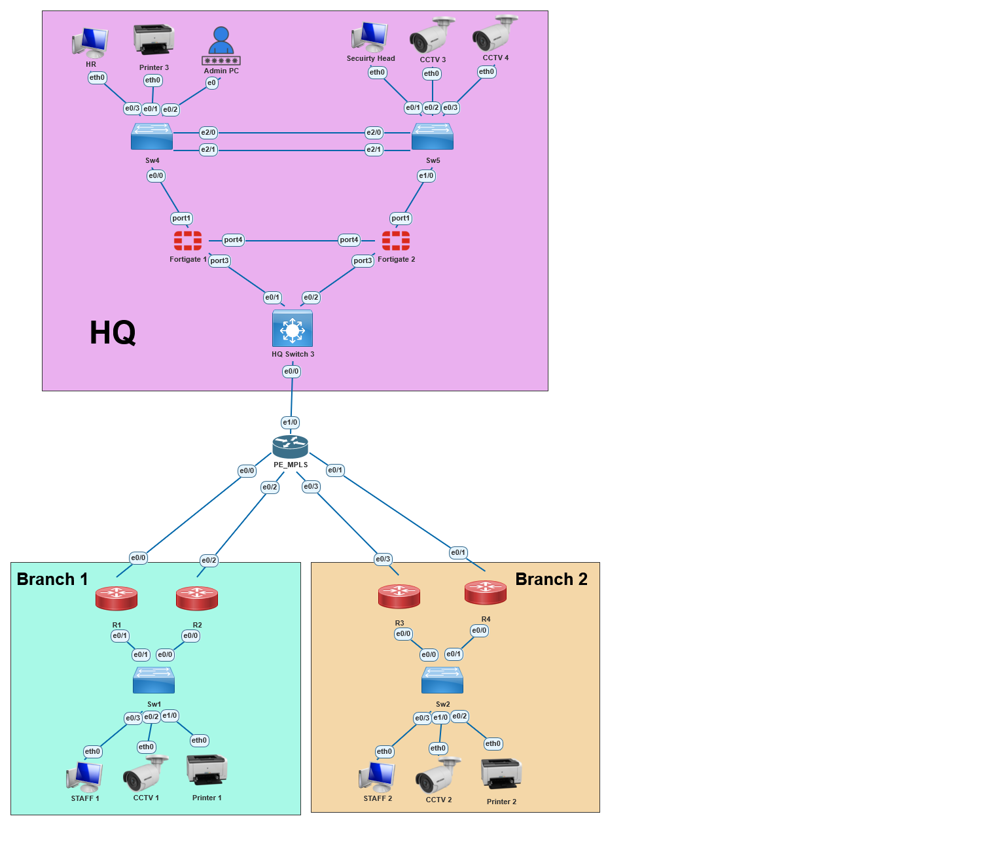

The network is split into three sites: **HQ, Branch 1, and Branch 2**. A router named `PE_MPLS` represents the provider network and connects the three sites.

Both branches follow the same basic design: one Layer 3 switch handles the local VLAN gateways and inter-VLAN routing, while two routers provide separate paths toward the provider. I used two WAN routers because allowing the branch to keep a redundant possible path if one router or one provider-facing link is lost.

HQ is designed differently because it is the main security and management site. It has two switches connected with an LACP EtherChannel and two FortiGates running as an active/passive HA pair.

For the provider-facing side of HQ, I chose to place a shared transit switch between the FortiGate pair and `PE_MPLS`. The alternative would have been to give each FortiGate its own dedicated provider-facing connection. Using the shared switch keeps the design simpler and reduces the number of links and interfaces needed, which is closer to the kind of cost trade-off that can exist in a real network.

Security follows the actual traffic path. Traffic going to or from HQ crosses the FortiGate, so the firewall is the main policy point for HQ. Branch-to-branch traffic can stay inside the provider path and never reach the FortiGate, so the branch Layer 3 switches also use ACLs to protect sensitive networks such as CCTV.

For example, traffic from a Branch 1 Staff PC to an HQ Staff follows this path:

```text
Branch endpoint → Branch L3 switch → R1 or R2 → PE_MPLS → HQ transit switch → FortiGate HA pair → HQ VLAN
```

Traffic to the outside, for example, if Staff in Branch 1 want to reach the Internet, the traffic will have to pass through FortiGate first.
this step and the firewall poilcy isnt configured yet but its upgradble and future real internet connection is in the way

---

## 2. VLAN and IP Plan

I kept the VLAN roles the same at every site so the design is easy to read:

| VLAN | Role |
|---:|---|
| 10 | Staff |
| 20 | CCTV |
| 30 | Printers |
| 99 | Administration / Management |

Each site uses different subnets, but the addressing follows a pattern:

```text
Branch 1: 192.168.10.0 / 20.0 / 30.0
Branch 2: 192.168.110.0 / 120.0 / 130.0
HQ:       192.168.210.0 / 220.0 / 230.0
```

That makes it easier to identify both the site and the device role from the IP address. For example, `192.168.220.x` belongs to the HQ CCTV network.

At HQ, the VLAN gateways are FortiGate subinterfaces. The screenshot below shows VLAN 10 for HQ Staff on `port1` with gateway `192.168.210.1/24`.

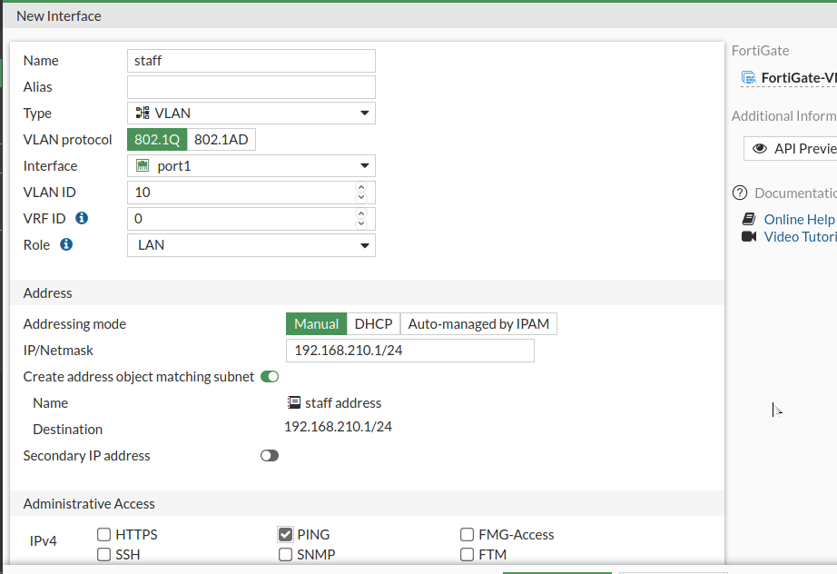

### Branch 1

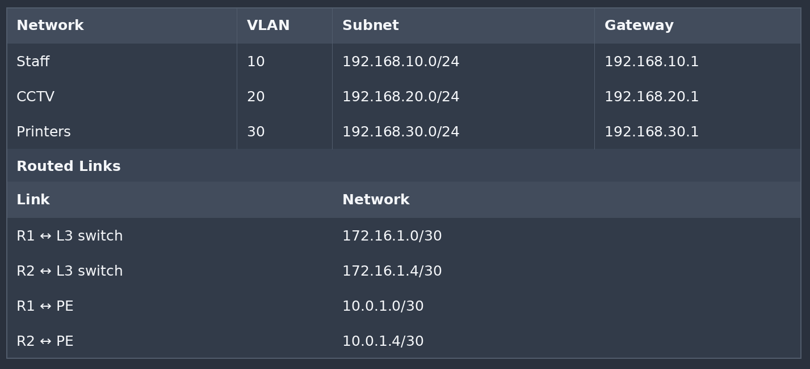

### Branch 2

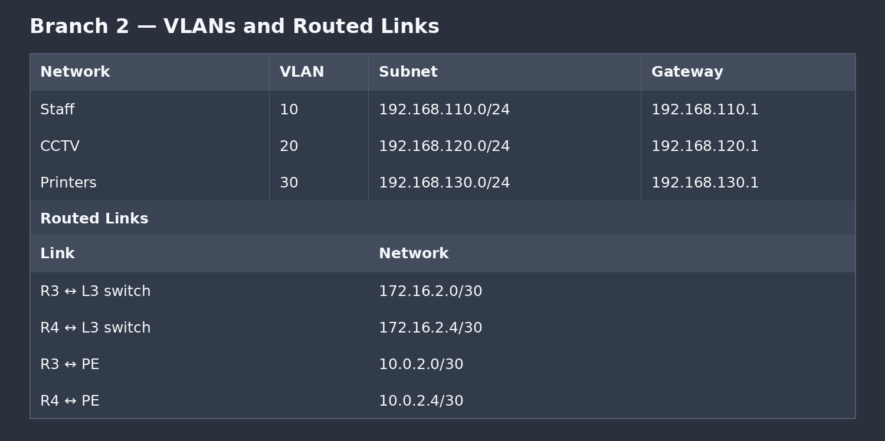

### HQ

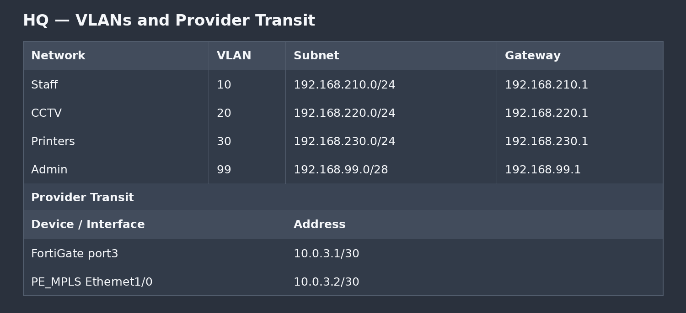

The point-to-point routed links use `/30` networks because only two usable addresses are needed on each link.

---

## 3. Routing Design

`PE_MPLS` acts as the central provider/transit router between HQ and both branches.

The name represents the provider role in the topology; this lab does **not** implement MPLS label switching, LDP, or MPLS VPNs. The provider side is IP routing with OSPF.

| Link | PE Interface | Address |
|---|---|---|
| Branch 1 — R1 | Ethernet0/0 | `10.0.1.1/30` |
| Branch 1 — R2 | Ethernet0/2 | `10.0.1.5/30` |
| Branch 2 — R3 | Ethernet0/3 | `10.0.2.1/30` |
| Branch 2 — R4 | Ethernet0/1 | `10.0.2.5/30` |
| HQ — FortiGate | Ethernet1/0 | `10.0.3.2/30` |

I used **OSPF Area 0** for dynamic routing. OSPF was the routing protocol I knew from my CCNA studies, and it fit what I needed here.

On the HQ side, the FortiGate forms an OSPF adjacency with `10.0.3.2` and advertises the HQ networks.

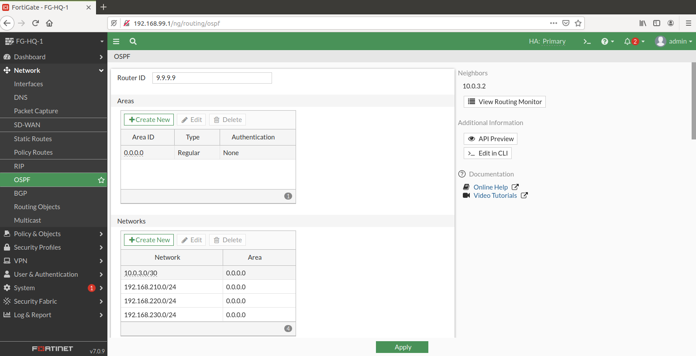

I also verified basic Layer 3 connectivity between the provider router and the FortiGate before working on firewall policy.

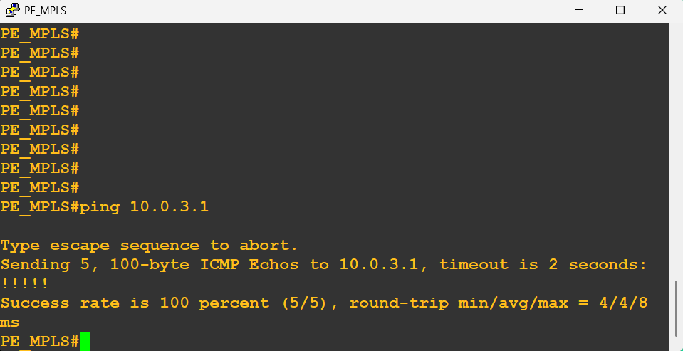

---

## 4. FortiGate HA and Security Policy

The HQ uses two FortiGate VMs in an **active/passive HA pair**. `port4` is used as the heartbeat link between them.

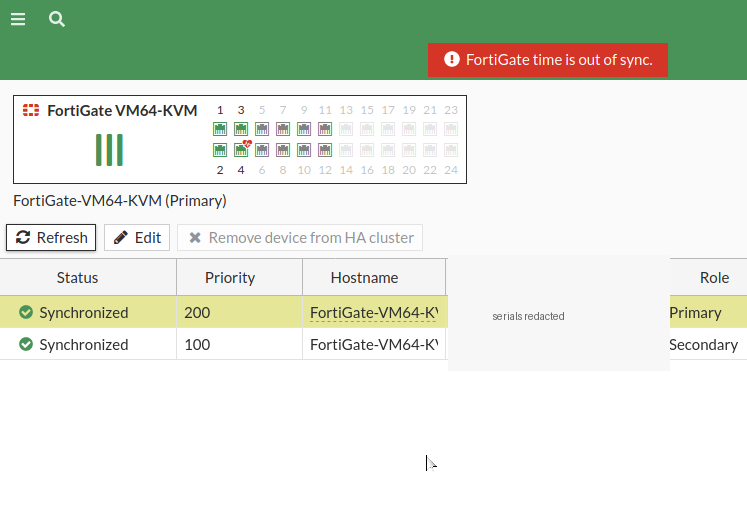

The cluster reached a synchronized Primary/Secondary state. HA removes the individual firewall as a single point of failure, although the shared HQ transit switch described earlier is still common to both firewalls.

### Address objects and groups

I created address objects for the networks instead of building policies around raw IP addresses.

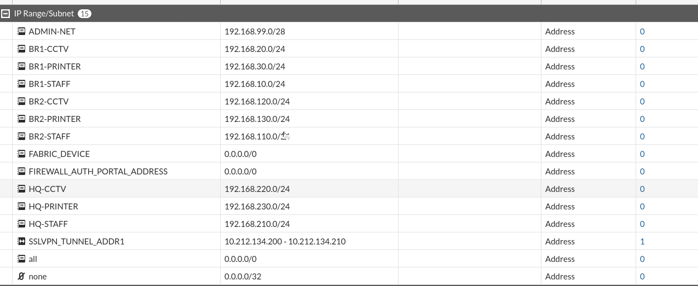

Examples:

```text
BR1-STAFF     192.168.10.0/24
BR1-CCTV      192.168.20.0/24
BR1-PRINTER   192.168.30.0/24
BR2-STAFF     192.168.110.0/24
BR2-CCTV      192.168.120.0/24
BR2-PRINTER   192.168.130.0/24
HQ-STAFF      192.168.210.0/24
HQ-CCTV       192.168.220.0/24
HQ-PRINTER    192.168.230.0/24
ADMIN-NET     192.168.99.0/28
```

Objects with the same role are grouped together, for example `ALL-STAFF`.

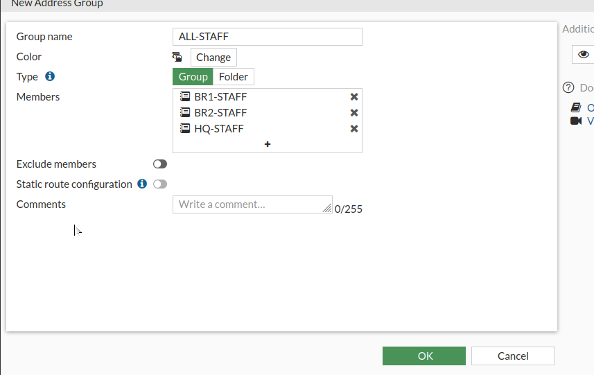

That keeps the firewall rules readable. A rule using `ALL-STAFF` is easier to understand later than a rule containing several unrelated-looking subnets.

### Firewall policy

The policy is based on allowing the traffic that is actually required and leaving the rest to FortiGate's implicit deny.

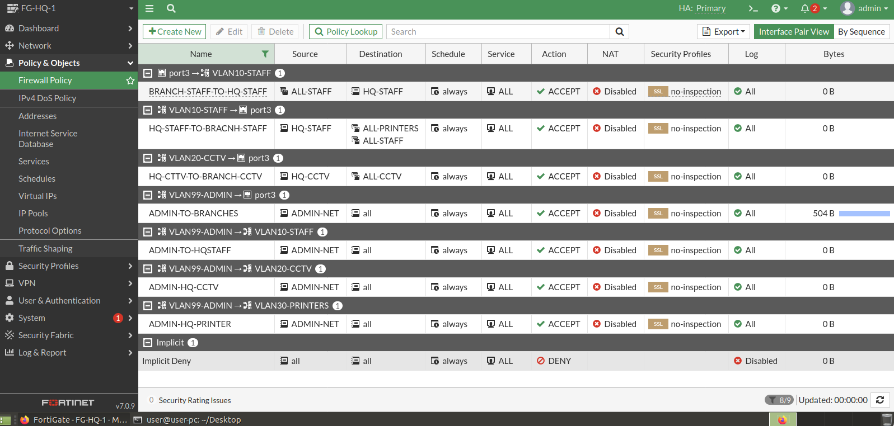

| Source | Destination | Result |
|---|---|---|
| Branch Staff | HQ Staff | Allow |
| HQ Staff | Branch Staff / Printers | Allow |
| HQ Security / CCTV | Branch CCTV | Allow |
| Admin | Branch networks | Allow |
| Admin | HQ Staff / CCTV / Printer VLANs | Allow |
| Other unmatched traffic | Protected networks | Implicit deny |

FortiGate is stateful, so return traffic for an established allowed session does not need a second reverse rule.

---

## 5. Branch ACL Security

The FortiGate is not in the path for every packet in the network. Branch-to-branch traffic can cross the provider directly, so I could not rely on the HQ firewall to protect the branch CCTV networks.

For that reason, I used extended ACLs on the branch Layer 3 switches to control traffic going toward CCTV.

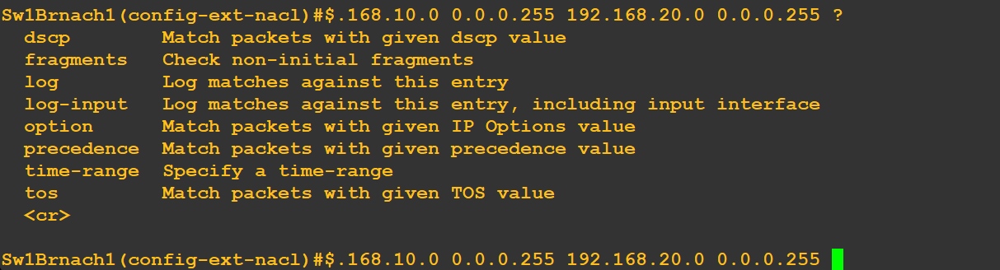

I used an extended ACL because I needed to match both the **source** and the **destination** instead of filtering only by source network.

The ACL was tested from a VPCS host:

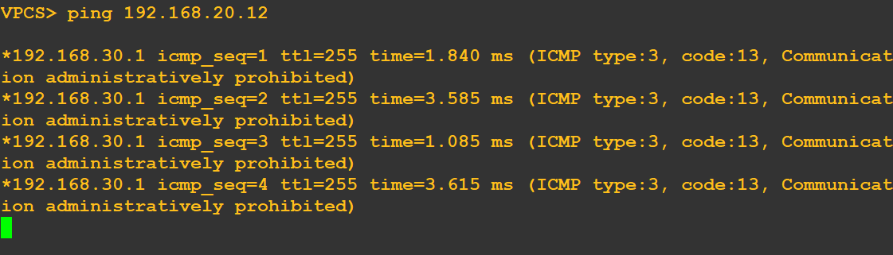

The `administratively prohibited` response was useful during testing because it showed that the packet reached the routing device and was intentionally rejected by the ACL, instead of simply disappearing because of a routing problem.

At HQ, I did not duplicate the same ACL design because the FortiGate already sits between the relevant networks and handles that policy there.

---

## 6. HQ Switching and EtherChannel

`HqSwitch4` and `HqSwitch5` are connected using a two-link **LACP EtherChannel**.

The Port-Channel carries VLANs `10,20,30,99`:

```cisco
interface Port-channel1
 switchport trunk encapsulation dot1q
 switchport trunk allowed vlan 10,20,30,99
 switchport mode trunk
```

The physical member interfaces use matching trunk settings and join `channel-group 1`.

I used EtherChannel for two reasons: it gives the switches more than one physical link between them without creating two independent Layer 2 paths, and one member link can fail while the Port-Channel stays up on the remaining link.

---

## 7. Management and SSH

I wanted the infrastructure to be managed through dedicated management addresses instead of randomly connecting to whichever routed interface was easiest to reach.

Branch routers and switches use loopback addresses as stable SSH targets. At HQ, management is separated through VLAN 99.

The Cisco SSH configuration follows this pattern:

```cisco
username admin secret \<REDACTED>
ip domain-name lab.lab
crypto key generate rsa modulus 2048
ip ssh version 2
line vty 0 4
 login local
 transport input ssh
```

The Linux admin workstation was then able to SSH to the branch management addresses.

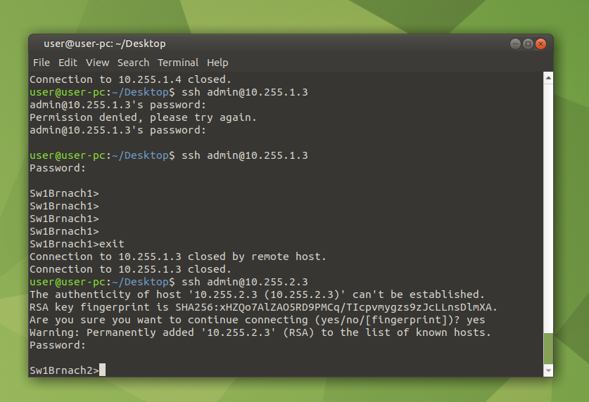

---

## 8. DHCP

Normal endpoints use DHCP, while infrastructure devices keep predictable static addresses.

At HQ, DHCP is provided by the FortiGate for the Staff, CCTV, and Printer VLANs:

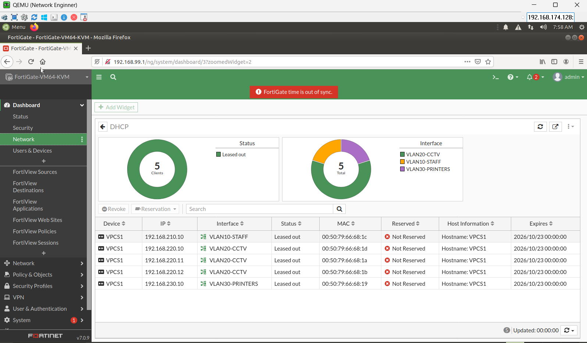

At the branches, the Layer 3 switches provide DHCP locally for their VLANs.

A VPCS client successfully received an IP address and default gateway through DHCP:

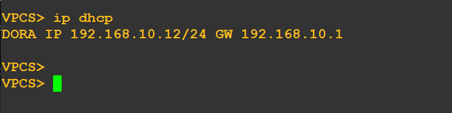

---

## 9. Layer-2 Access Security

Port Security is enabled on endpoint-facing switchports.

The reason is practical: if someone disconnects a known endpoint and connects another device to the same access port, I do not want the switch to automatically accept a different MAC address.

```cisco
switchport port-security
switchport port-security mac-address sticky
switchport port-security violation shutdown
```

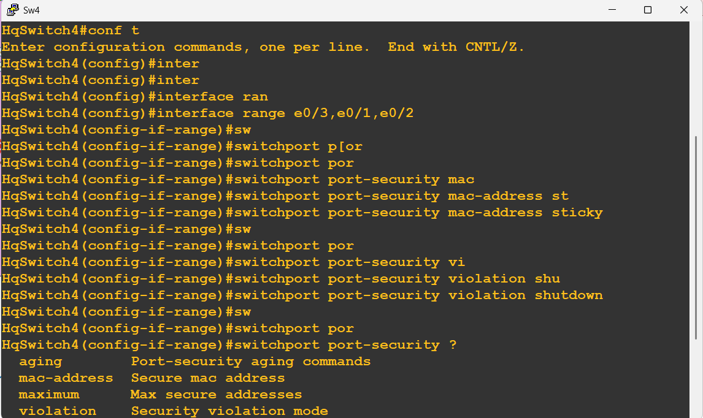

I only use it on access-facing ports. Trunks, routed uplinks, and EtherChannel members are left out because multiple MAC addresses can legitimately appear there.

---

## 11. Troubleshooting Highlights

### EtherChannel would not bundle

**Symptom:** IOS generated `%EC-5-CANNOT_BUNDLE2`.

**Cause:** I had configured the trunk on the Port-Channel, but the physical member interfaces did not have matching trunk parameters.

**Fix:** I configured the member interfaces with the same `dot1q` trunk settings before adding them to the channel group.

### Modern Linux SSH client rejected the Cisco connection

**Symptom:** `no matching cipher found`.

**Cause:** The older IOS image only offered SSH algorithms that modern OpenSSH disables by default.

**Fix:** I kept SSHv2 enabled on Cisco and allowed the required legacy algorithms only for the lab management ranges on the Linux client.

### FortiGate replied to ping but the GUI did not open over HTTPS

The network path was working because the firewall replied to ICMP, but that did not mean the HTTPS management service was working correctly. With this FortiGate image, I used HTTP management as a lab workaround.

> HTTP was only used as a workaround inside the lab. It is not how I would expose firewall management in a production network.
